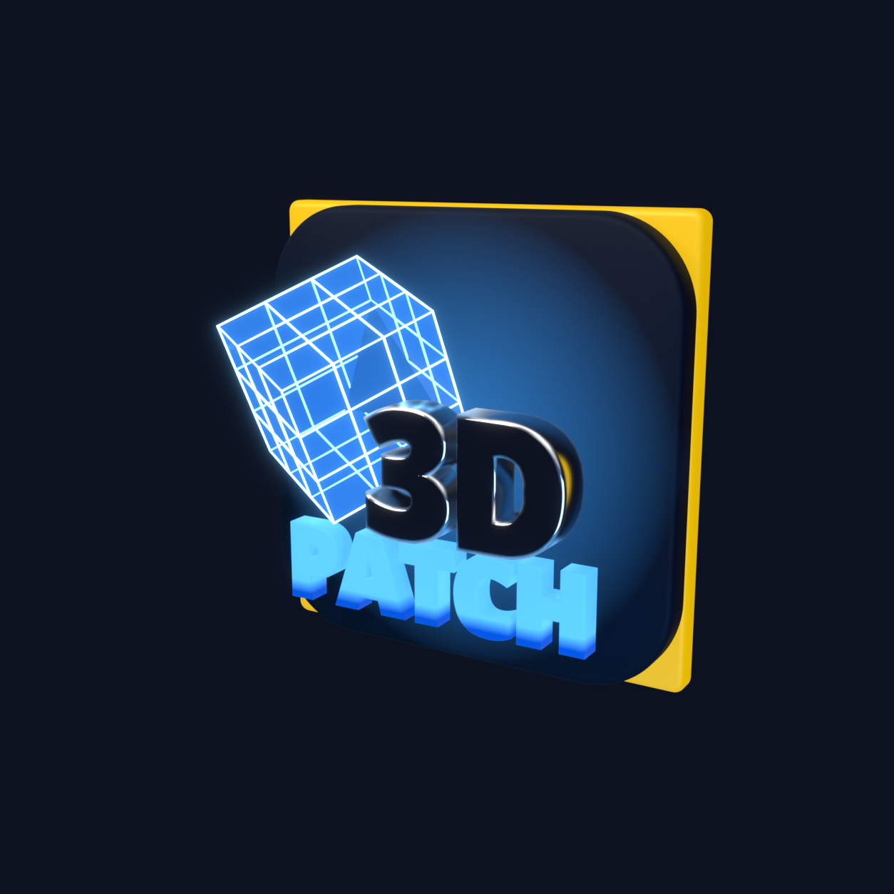
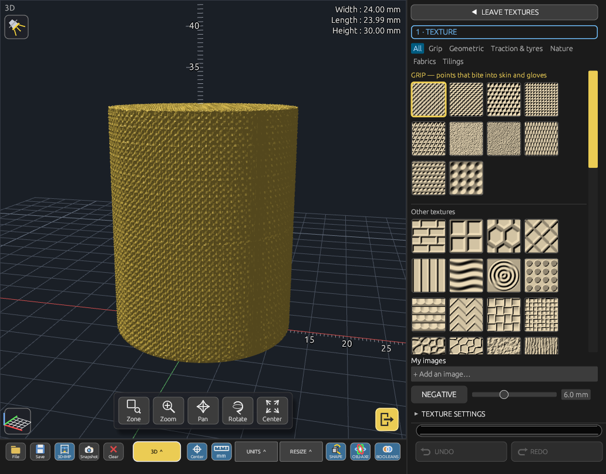

<p align="center"></p>

<h1 align="center">3D-Patch</h1>

<p align="center">[English](README.md) · [Français](README.fr.md) · [Español](README.es.md) · [Italiano](README.it.md) · [Deutsch](README.de.md)</p>

<p align="center">3D-Modellierer für den 3D-Druck — Modelle reparieren, bearbeiten und vorbereiten in einer einzigen freien Anwendung.</p>



## Was ist 3D-Patch?

3D-Patch ist ein Desktop-3D-Modellierer im Stil von Microsoft 3D Builder, geschrieben in Rust auf Basis des industriellen Geometriekerns **OpenCASCADE**. Er öffnet nahezu jede 3D-Datei, findet und repariert die Fehler, an denen ein Druck scheitert (Löcher, umgedrehte oder defekte Flächen), erlaubt das Bearbeiten des Objekts (schneiden, vereinen, aushöhlen, gravieren, Text, Bilder und Relieftexturen wie Grips hinzufügen) und schickt es druckfertig an Ihren Slicer.

Er läuft unter Linux und Windows, vollständig offline, und die Oberfläche ist auf Französisch, Englisch, Spanisch, Italienisch und Deutsch verfügbar.

## Funktionen

- **Ansichten**: texturiert, transparent, Drahtgitter sowie eine Ansicht *Fehler & Defekte*, die Probleme farbig hervorhebt.
- **Reparatur**: Erkennung von Löchern und fehlerhaften Flächen, interne Bereinigung, automatische Reparatur per Klick und eine „A.I.“-Reparatur, die eine geschlossene (wasserdichte) Hülle neu aufbaut.
- **Bearbeitung**: Boolesche Operationen (Vereinigung, Subtraktion, Schnittmenge), Schnitt entlang einer Ebene, Aushöhlen mit Ablauflöchern, Vereinfachung, Gitterobjekte, Relief-/Texturgravur, 3D-Text sowie in Schwarzweiß vektorisierte Bilder (Schwelle, automatisch, adaptiv oder nach Farben, einstellbare Toleranz, Negativ, Rahmen entfernen), erhaben oder graviert wie Text.
- **Relieftexturen**: 76 eingebaute, von 3D-Patch berechnete Muster (keine Bilddateien) in Registern — darunter eine **Grip**-Familie mit spitzen Mikrospitzen, die an Haut und Handschuhen greifen (Fischhaut, Punzierung, Mikrospitzen, Diamantspitzen, Rändelung, Raspel, Dornen, Griptape…) — sowie eigene Bilder. Live-Vorschau, Größenregler, Schaltfläche *Negativ*, erhaben oder graviert, Umhüllung triplanar / Würfel / flach / Zylinder / Kugel, Ebenen. Glatte Bereiche mit **Pinsel**, **Fläche** (ein Klick nimmt eine ganze Fläche, kleine Stufen bis 0,5 mm inbegriffen) oder **Radierer**; Rechtsklick macht die letzte Ausnahme rückgängig. Die adaptive Engine fügt nur dort Dreiecke hinzu, wo das Relief sie braucht, hält das Teil geschlossen und die Unterseite flach auf dem Druckbett.
- **Platzierung**: Gizmo zum Verschieben/Drehen/Skalieren, exakte Maße in mm/cm/Zoll, Zentrieren, Lineal, Ablegen auf dem Druckbett mit realistischer Schwerkraftsimulation, Auflegen des Objekts auf jede ebene Fläche (Flächenanalyse mit Fortschrittsanzeige und Flächenliste).
- **Teile & Gruppen**: ein Teil eines mehrteiligen Objekts anklicken und Rechtsklick → *Trennen*; mehrere Objekte mit Umschalt+Klick wählen und Rechtsklick → *Gruppieren*; Kopieren/Einfügen (Strg+C / Strg+V), Löschen mit Entf oder Rücktaste.
- **Druckvorbereitung**: Prüfungen (Dichtheit, Überhänge, dünne Wände, Größe), empfohlene Ausrichtung, Schätzung des Materialgewichts, direkte Übergabe an installierte Slicer (PrusaSlicer, Cura, OrcaSlicer, Bambu Studio, SuperSlicer, Creality Print…).
- **Betrachtermodus**: 3D-Patch kann zur Standardanwendung für 3D-Dateien werden (Doppelklick zum Anzeigen).

## Unterstützte Formate

Import: STL, OBJ, PLY, 3MF, STEP, IGES, Rhino/MoI 3DM, SketchUp SKP, FBX, glTF/GLB, DAE, 3DS, X3D, FreeCAD FCStd, DXF, SolidCraft (.solidcraft), Blender (über ein installiertes Blender)… — Export: STL, 3MF (mit Farben), OBJ, PLY, Rhino/MoI 3DM, SketchUp SKP, 3DS, FBX, DAE, glTF/GLB, X3D, SolidCraft.

SolidCraft-Konstruktionen: Netze und importierte STEP-Teile werden direkt gelesen, ohne SolidCraft. Eine rein parametrische Konstruktion (Skizzen, Extrusionen, Verrundungen…) enthält keine Geometrie: Ist SolidCraft installiert, lässt 3D-Patch sie dort berechnen und behält das Ergebnis, sodass dieselbe Datei sofort wieder öffnet. Beim Speichern als SolidCraft wird jedes Objekt als importiertes Netz geschrieben, das SolidCraft öffnet.

## Download

Fertige Versionen gibt es auf der Seite [Releases](https://github.com/OMNIA-AI-Group/3D-Patch/releases):

| Datei | System | Installation |
|---|---|---|
| `3D-Patch-x86_64.AppImage` | jedes Linux x86-64 | `chmod +x`, dann Doppelklick |
| `3d-patch_<version>-1_amd64.deb` | Debian, Ubuntu, Mint, Zorin, Pop!_OS… | `sudo apt install ./3d-patch_<version>-1_amd64.deb` |
| `3d-patch-bin-<version>-1-x86_64.pkg.tar.zst` | Arch Linux, Manjaro, EndeavourOS… | `sudo pacman -U 3d-patch-bin-<version>-1-x86_64.pkg.tar.zst` (oder `makepkg -si` mit [`paquets/PKGBUILD`](paquets/PKGBUILD)) |
| `3d-patch-<version>-linux-x86_64.tar.gz` | jedes Linux (manuell) | nach `/` entpacken: `/opt/3d-patch` + Starter |
| `3D-Patch-Setup.exe` | Windows 10/11 | Installer |
| `3D-Patch-Windows-portable.zip` | Windows 10/11 | entpacken, `3D-Patch\3d-patch.exe` starten |

## Aus dem Quellcode bauen (Linux)

Getestet unter Ubuntu 24.04 / Zorin OS 18 mit Rust ≥ 1.80. Die Schritte für Rhino 3DM und SketchUp sind optional: Ohne sie wird 3D-Patch ohne diese beiden Formate gebaut.

```bash
sudo apt install build-essential cmake ninja-build pkg-config libgtk-3-dev \
  libocct-foundation-dev libocct-modeling-data-dev libocct-modeling-algorithms-dev \
  libocct-data-exchange-dev libassimp-dev

git clone --recursive https://github.com/OMNIA-AI-Group/3D-Patch.git
cd 3D-Patch

# Optional — Unterstützung für Rhino 3DM (openNURBS)
git -C libs/opennurbs apply ../../patches/opennurbs.patch
cmake -S libs/opennurbs -B libs/opennurbs/build -DCMAKE_BUILD_TYPE=Release
cmake --build libs/opennurbs/build -j

# Optional — Unterstützung für SketchUp (OpenSKP)
git -C libs/skp-iamahsanmehmood apply ../../patches/openskp.patch
cmake -S libs/skp-iamahsanmehmood/packages/cpp -B libs/skp-iamahsanmehmood/packages/cpp/build \
  -G Ninja -DCMAKE_BUILD_TYPE=Release -DOPENSKP_BUILD_TESTS=OFF
cmake --build libs/skp-iamahsanmehmood/packages/cpp/build

cd 3D-Patch && cargo build --release
./target/release/3d-patch
```

Die Windows-Version wird unter Linux mit MinGW-w64 kreuzkompiliert (siehe `winbuild/mingw-w64.cmake` und das NSIS-Skript `winbuild/3d-patch.nsi`).

## Aufbau des Repositorys

- `3D-Patch/` — die Anwendung (Rust in `src/`, C++-Brücken zu OpenCASCADE, Assimp, openNURBS und OpenSKP in `cpp/`)
- `libs/` — openNURBS und OpenSKP (Git-Submodule), `patches/` — die kleinen Änderungen daran
- `IMAGES/` — Logo und seine Blender-Quelle, `winbuild/` — Windows-Paketierung, `install-systeme.sh` — lokale Installation nach `/opt`

## Lizenz

3D-Patch ist freie Software unter der **GNU General Public License v3.0** — siehe [LICENSE](LICENSE). Sie dürfen sie nutzen, untersuchen, verändern und weitergeben; veränderte Versionen, die Sie verbreiten, müssen unter derselben Lizenz bleiben.

Komponenten von Drittanbietern: OpenCASCADE (LGPL-2.1), manifold-rust (Apache-2.0), openNURBS (McNeel-Lizenz), OpenSKP (MIT), Assimp (BSD-3), egui · glow · winit · glam (MIT/Apache-2.0), rfd · image (MIT).

## Autor

**Alain Valette-Clary** — ΩiA-Group · [LinkedIn](https://www.linkedin.com/in/alain-valette-clary-524b28352/)

© 2026 Alain Valette-Clary / ΩiA-Group
